<a href="https://yshubham.com">
  
</a>

  <a href="https://yshubham.com">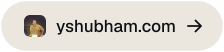</a>
  
  
  
  

 

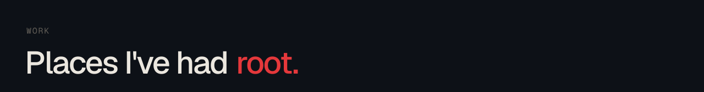

<a href="https://yshubham.com/work/">
  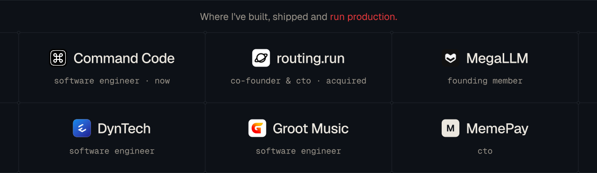
</a>

 
 

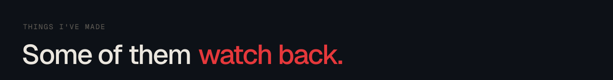

  <a href="https://github.com/bas3line/ascii"></a>
  <a href="https://github.com/bas3line/Airsec">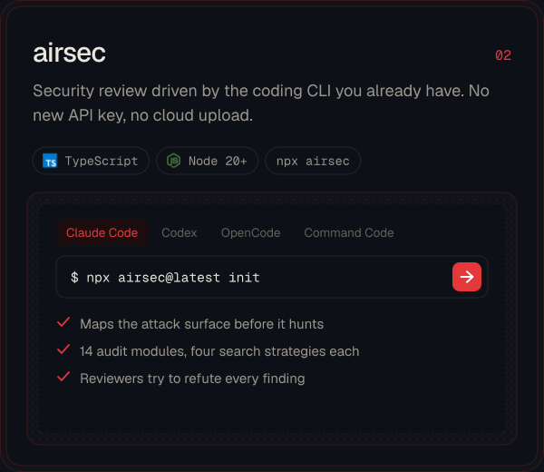</a>
  <a href="https://github.com/bas3line/Gopher"></a>
  <a href="https://github.com/bas3line/packets">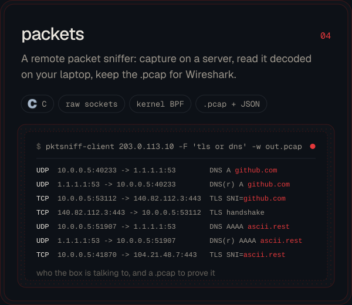</a>
  <a href="https://github.com/bas3line/honeypot"></a>
  <a href="https://github.com/bas3line/ultrabalancer"></a>

  <a href="https://github.com/bas3line/tplay"></a>

  and
  <a href="https://github.com/bas3line/agent-office"> agent office</a> ·
  <a href="https://github.com/bas3line/Components"> components</a> ·
  <a href="https://github.com/bas3line/amv"> amv</a> ·
  <a href="https://github.com/bas3line/lineup"> lineup</a> ·
  <a href="https://github.com/bas3line/pi-boat"> pi-boat</a> ·
  <a href="https://github.com/bas3line/penna"> penna</a> ·
  <a href="https://github.com/bas3line/s3lean"> s3lean</a> ·
  <a href="https://github.com/bas3line/sandbox"> sandbox</a> ·
  <a href="https://github.com/bas3line/watchman"> watchman</a> ·
  <a href="https://github.com/bas3line/Context-Bridge"> context bridge</a> ·
  <a href="https://saucer.sh"> saucer.sh</a>

 

<a href="https://github.com/bas3line?tab=repositories">
  
</a>

 
 

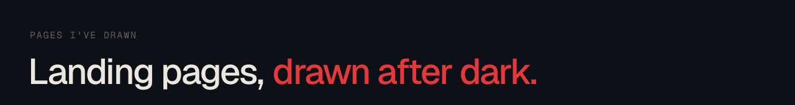

  <a href="https://nodeny.kiraa-7e4.workers.dev">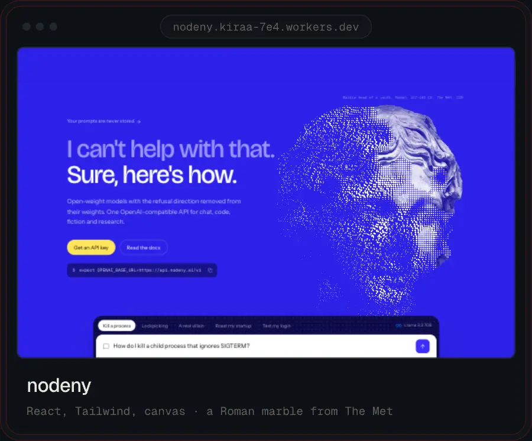</a>
  <a href="https://turtle.kiraa-7e4.workers.dev">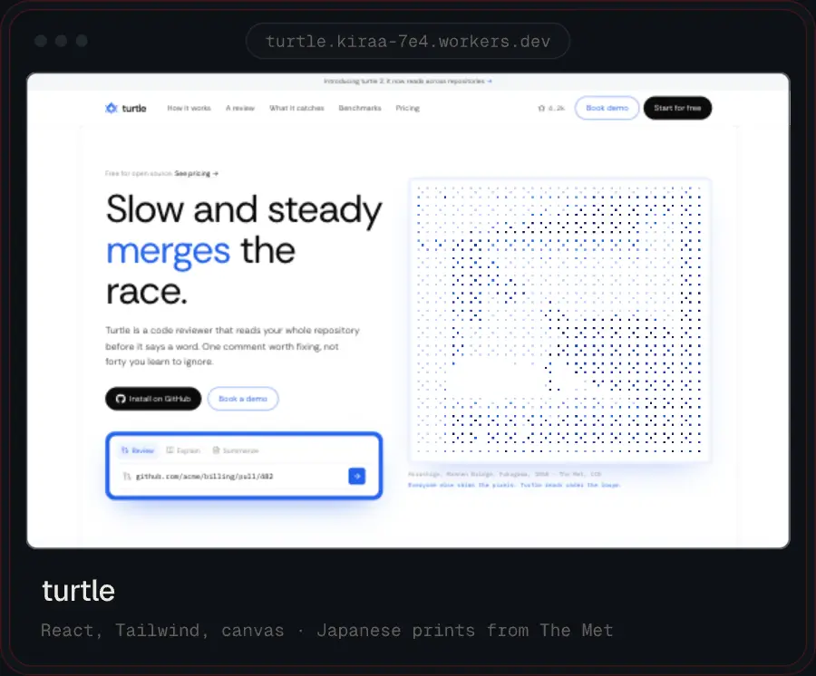</a>
  <a href="https://absolute.kiraa-7e4.workers.dev">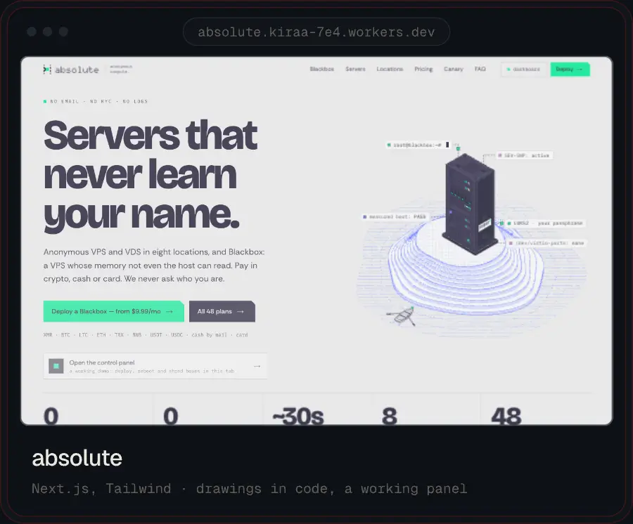</a>
  <a href="https://ascii.rest">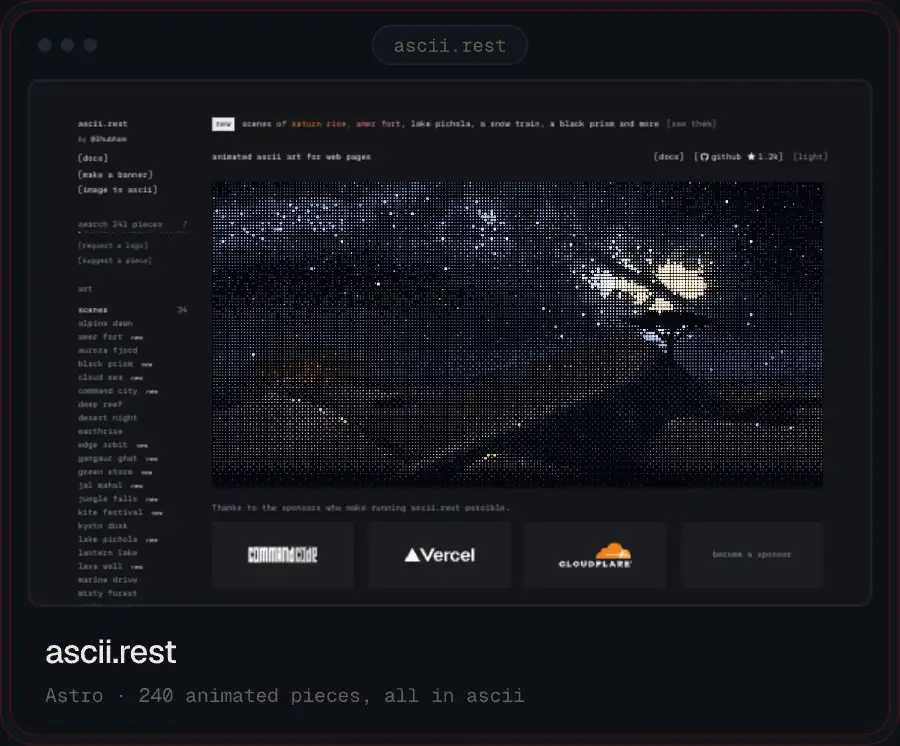</a>

 

  set in Geist · drawn by <a href=".github/readme">.github/readme</a>

