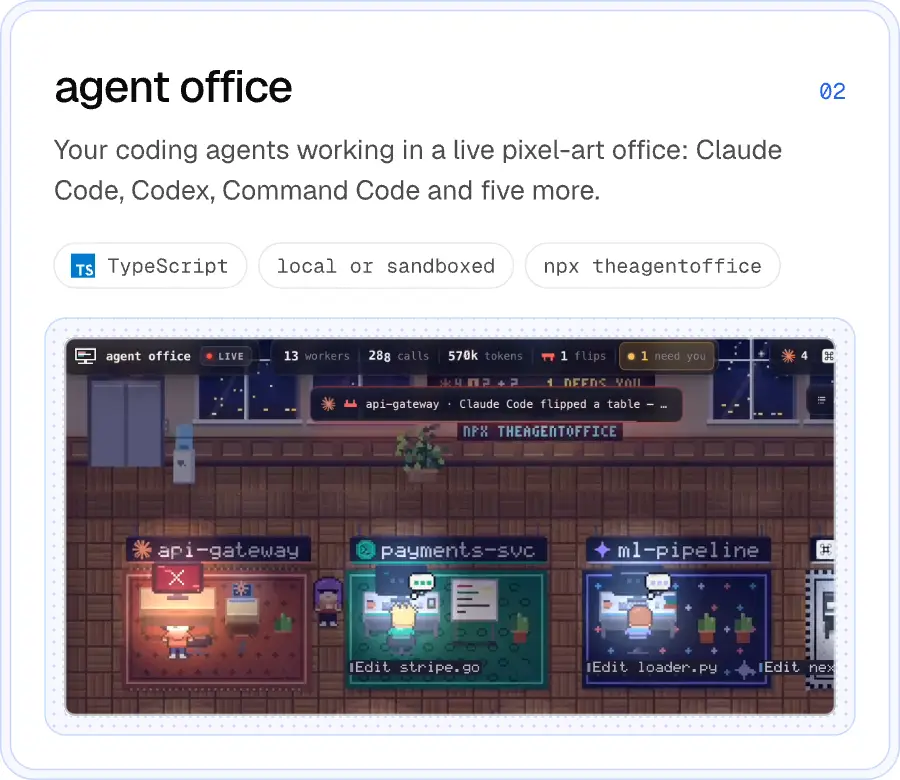
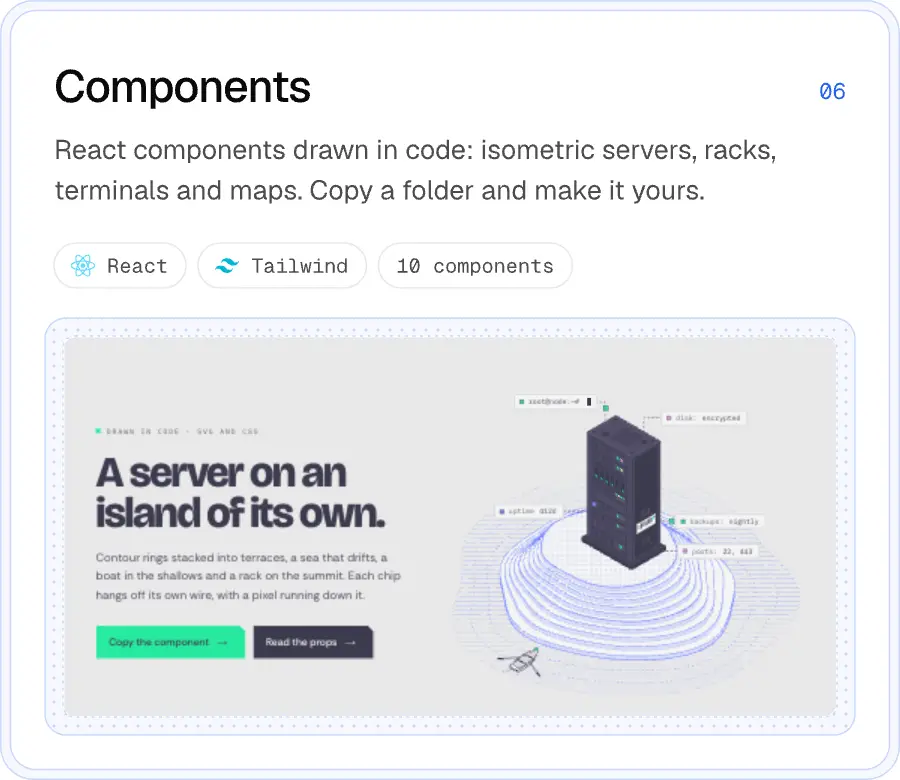
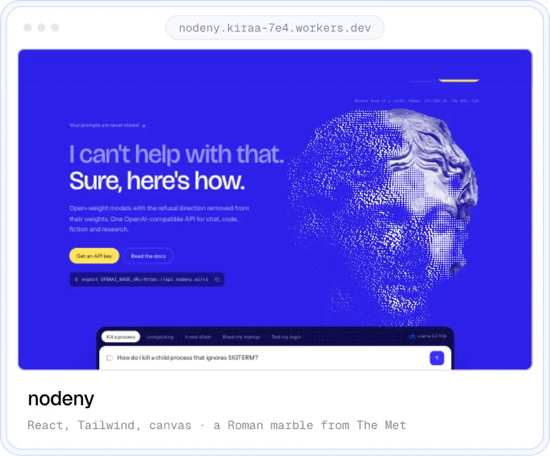
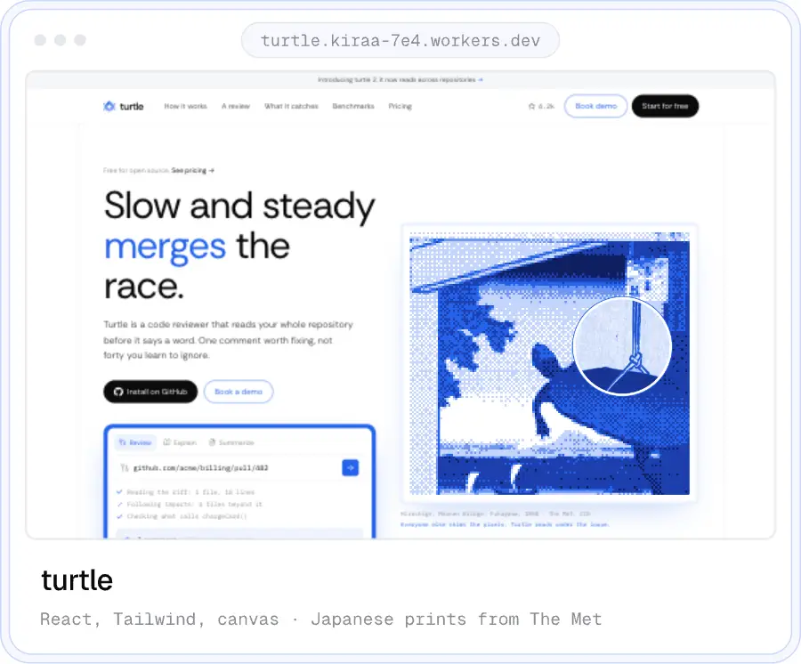
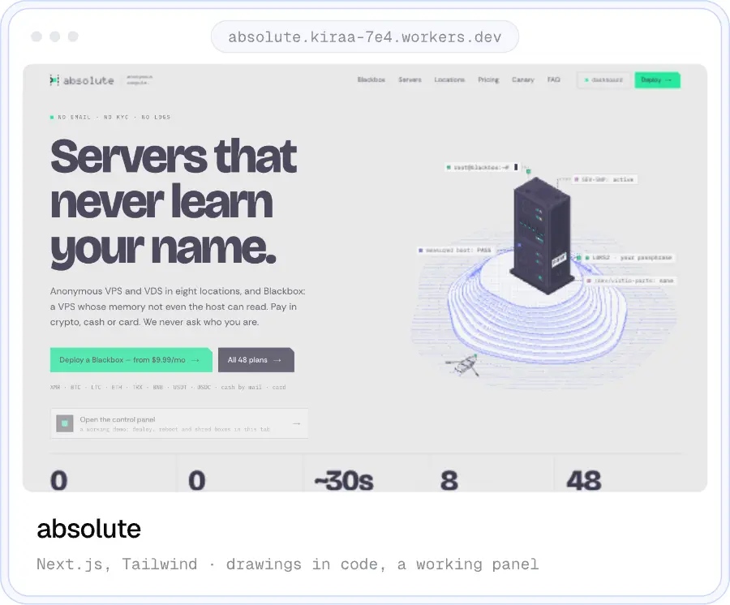
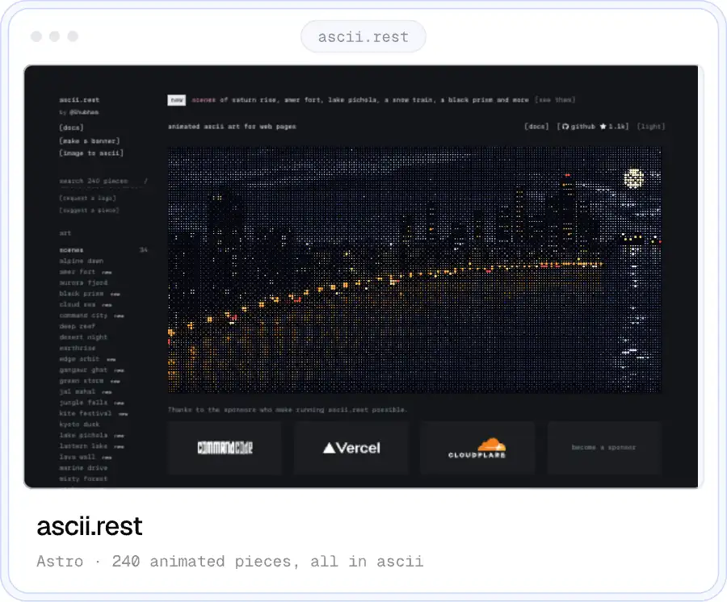

<a href="https://yshubham.com">
  <picture>
    <source media="(prefers-color-scheme: dark)" srcset="assets/readme/hero-dark.svg">
    
  </picture>
</a>

  <a href="https://yshubham.com"><picture><source media="(prefers-color-scheme: dark)" srcset="assets/readme/btn-site-dark.svg"></picture></a>
  <a href="https://cal.com/shubhamyadav"><picture><source media="(prefers-color-scheme: dark)" srcset="assets/readme/btn-call-dark.svg"></picture></a>
  <a href="mailto:hi@yshubham.com"><picture><source media="(prefers-color-scheme: dark)" srcset="assets/readme/btn-mail-dark.svg"></picture></a>
  <a href="https://x.com/inlovewithgo"><picture><source media="(prefers-color-scheme: dark)" srcset="assets/readme/btn-x-dark.svg"></picture></a>
  <a href="https://www.linkedin.com/in/extractings/"><picture><source media="(prefers-color-scheme: dark)" srcset="assets/readme/btn-linkedin-dark.svg"></picture></a>

 

<picture>
  <source media="(prefers-color-scheme: dark)" srcset="assets/readme/heading-work-dark.svg">
  
</picture>

<a href="https://yshubham.com/work/">
  <picture>
    <source media="(prefers-color-scheme: dark)" srcset="assets/readme/work-dark.svg">
    
  </picture>
</a>

 
 

<picture>
  <source media="(prefers-color-scheme: dark)" srcset="assets/readme/heading-projects-dark.svg">
  
</picture>

  <a href="https://github.com/bas3line/ascii"><picture><source media="(prefers-color-scheme: dark)" srcset="assets/readme/card-ascii-dark.svg"></picture></a>
  <a href="https://github.com/bas3line/agent-office"><picture><source media="(prefers-color-scheme: dark)" srcset="assets/readme/card-agent-office-dark.webp"></picture></a>
  <a href="https://github.com/bas3line/Airsec"><picture><source media="(prefers-color-scheme: dark)" srcset="assets/readme/card-airsec-dark.svg"></picture></a>
  <a href="https://github.com/bas3line/Gopher"><picture><source media="(prefers-color-scheme: dark)" srcset="assets/readme/card-gopher-dark.svg"></picture></a>
  <a href="https://github.com/bas3line/tplay"><picture><source media="(prefers-color-scheme: dark)" srcset="assets/readme/card-tplay-dark.svg"></picture></a>
  <a href="https://github.com/bas3line/Components"><picture><source media="(prefers-color-scheme: dark)" srcset="assets/readme/card-components-dark.webp"></picture></a>

  and
  <a href="https://github.com/bas3line/amv"> amv</a> ·
  <a href="https://github.com/bas3line/lineup"> lineup</a> ·
  <a href="https://github.com/bas3line/pi-boat"> pi-boat</a> ·
  <a href="https://github.com/bas3line/penna"><picture><source media="(prefers-color-scheme: dark)" srcset="assets/tech/rust-dark.svg"></picture> penna</a> ·
  <a href="https://github.com/bas3line/s3lean"><picture><source media="(prefers-color-scheme: dark)" srcset="assets/tech/rust-dark.svg"></picture> s3lean</a> ·
  <a href="https://github.com/bas3line/sandbox"><picture><source media="(prefers-color-scheme: dark)" srcset="assets/tech/rust-dark.svg"></picture> sandbox</a> ·
  <a href="https://github.com/bas3line/watchman"><picture><source media="(prefers-color-scheme: dark)" srcset="assets/tech/rust-dark.svg"></picture> watchman</a> ·
  <a href="https://github.com/bas3line/ultrabalancer"><picture><source media="(prefers-color-scheme: dark)" srcset="assets/tech/rust-dark.svg"></picture> ultrabalancer</a> ·
  <a href="https://github.com/bas3line/Context-Bridge"><picture><source media="(prefers-color-scheme: dark)" srcset="assets/tech/rust-dark.svg"></picture> context bridge</a> ·
  <a href="https://saucer.sh"> saucer.sh</a>

 

<a href="https://github.com/bas3line?tab=repositories">
  <picture>
    <source media="(prefers-color-scheme: dark)" srcset="assets/readme/timeline-dark.svg">
    
  </picture>
</a>

 
 

<picture>
  <source media="(prefers-color-scheme: dark)" srcset="assets/readme/heading-pages-dark.svg">
  
</picture>

  <a href="https://nodeny.kiraa-7e4.workers.dev"><picture><source media="(prefers-color-scheme: dark)" srcset="assets/readme/page-nodeny-dark.webp"></picture></a>
  <a href="https://turtle.kiraa-7e4.workers.dev"><picture><source media="(prefers-color-scheme: dark)" srcset="assets/readme/page-turtle-dark.webp"></picture></a>
  <a href="https://absolute.kiraa-7e4.workers.dev"><picture><source media="(prefers-color-scheme: dark)" srcset="assets/readme/page-absolute-dark.webp"></picture></a>
  <a href="https://ascii.rest"><picture><source media="(prefers-color-scheme: dark)" srcset="assets/readme/page-ascii-dark.webp"></picture></a>

 

  <i>Full Moon</i> by Lewis Morris Rutherfurd, 1871, <a href="https://www.metmuseum.org/art/collection/search/813902">The Met</a>, CC0 · set in Geist · drawn by <a href=".github/readme">.github/readme</a>

