<a href="https://yshubham.com">
  <picture>
    <source media="(prefers-color-scheme: dark)" srcset="assets/readme/hero-dark.svg">
    
  </picture>
</a>

  <a href="https://yshubham.com"><picture><source media="(prefers-color-scheme: dark)" srcset="assets/readme/btn-site-dark.svg">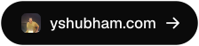</picture></a>
  <a href="https://cal.com/shubhamyadav"><picture><source media="(prefers-color-scheme: dark)" srcset="assets/readme/btn-call-dark.svg"></picture></a>
  <a href="mailto:hi@yshubham.com"><picture><source media="(prefers-color-scheme: dark)" srcset="assets/readme/btn-mail-dark.svg">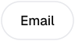</picture></a>
  <a href="https://x.com/inlovewithgo"><picture><source media="(prefers-color-scheme: dark)" srcset="assets/readme/btn-x-dark.svg"></picture></a>
  <a href="https://www.linkedin.com/in/extractings/"><picture><source media="(prefers-color-scheme: dark)" srcset="assets/readme/btn-linkedin-dark.svg"></picture></a>

 

<picture>
  <source media="(prefers-color-scheme: dark)" srcset="assets/readme/heading-projects-dark.svg">
  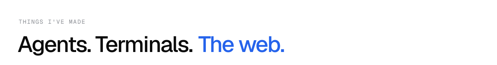
</picture>

  <a href="https://github.com/bas3line/ascii"><picture><source media="(prefers-color-scheme: dark)" srcset="assets/readme/card-ascii-dark.svg"></picture></a>
  <a href="https://github.com/bas3line/agent-office"><picture><source media="(prefers-color-scheme: dark)" srcset="assets/readme/card-agent-office-dark.svg"></picture></a>
  <a href="https://github.com/bas3line/Airsec"><picture><source media="(prefers-color-scheme: dark)" srcset="assets/readme/card-airsec-dark.svg">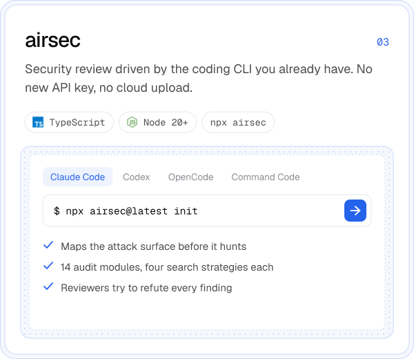</picture></a>
  <a href="https://github.com/bas3line/Gopher"><picture><source media="(prefers-color-scheme: dark)" srcset="assets/readme/card-gopher-dark.svg"></picture></a>
  <a href="https://github.com/bas3line/tplay"><picture><source media="(prefers-color-scheme: dark)" srcset="assets/readme/card-tplay-dark.svg"></picture></a>
  <a href="https://github.com/bas3line/lineup"><picture><source media="(prefers-color-scheme: dark)" srcset="assets/readme/card-lineup-dark.svg">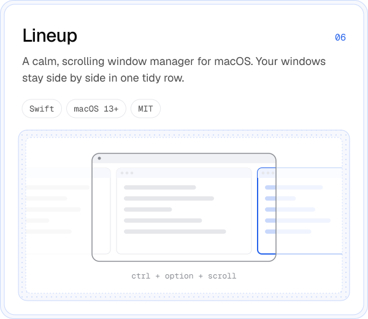</picture></a>

  and <a href="https://github.com/bas3line/amv">amv</a> · <a href="https://github.com/bas3line/Components">components</a> · <a href="https://github.com/bas3line/pi-boat">pi-boat</a> · <a href="https://github.com/bas3line/penna">penna</a> · <a href="https://github.com/bas3line/s3lean">s3lean</a> · <a href="https://github.com/bas3line/webhook-relay">webhook-relay</a> · <a href="https://github.com/bas3line/sandbox">sandbox</a> · <a href="https://github.com/bas3line/watchman">watchman</a> · <a href="https://github.com/bas3line/ultrabalancer">ultrabalancer</a> · <a href="https://github.com/bas3line/Context-Bridge">context bridge</a> · <a href="https://saucer.sh">saucer.sh</a>

 

<a href="https://github.com/bas3line?tab=repositories">
  <picture>
    <source media="(prefers-color-scheme: dark)" srcset="assets/readme/timeline-dark.svg">
    
  </picture>
</a>

 
 

<picture>
  <source media="(prefers-color-scheme: dark)" srcset="assets/readme/heading-pages-dark.svg">
  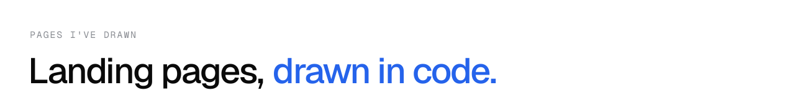
</picture>

  <a href="https://nodeny.kiraa-7e4.workers.dev"><picture><source media="(prefers-color-scheme: dark)" srcset="assets/readme/page-nodeny-dark.svg">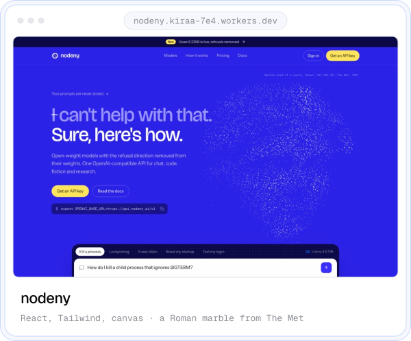</picture></a>
  <a href="https://turtle.kiraa-7e4.workers.dev"><picture><source media="(prefers-color-scheme: dark)" srcset="assets/readme/page-turtle-dark.svg">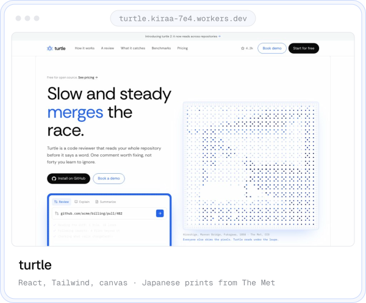</picture></a>
  <a href="https://absolute.kiraa-7e4.workers.dev"><picture><source media="(prefers-color-scheme: dark)" srcset="assets/readme/page-absolute-dark.svg">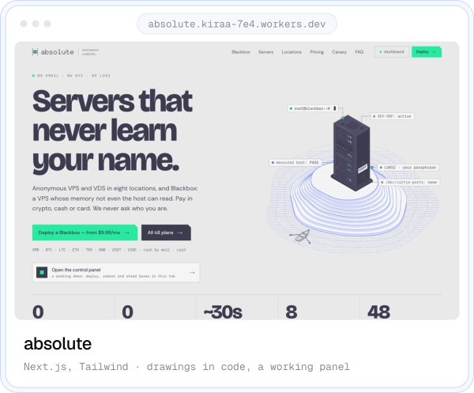</picture></a>
  <a href="https://ascii.rest"><picture><source media="(prefers-color-scheme: dark)" srcset="assets/readme/page-ascii-dark.svg">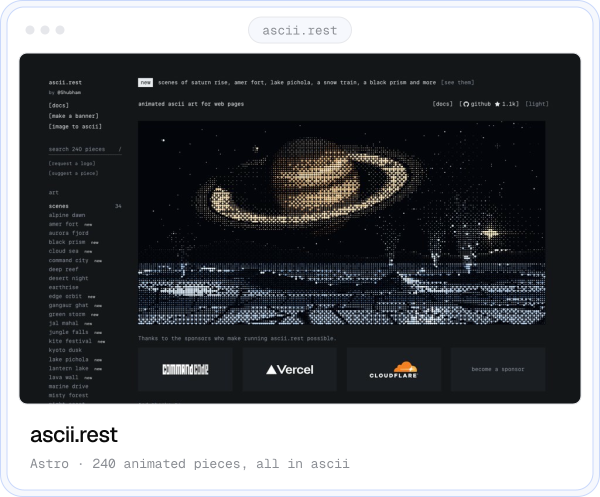</picture></a>

 

<picture>
  <source media="(prefers-color-scheme: dark)" srcset="assets/readme/heading-work-dark.svg">
  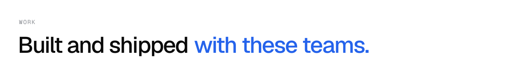
</picture>

<a href="https://yshubham.com/work/">
  <picture>
    <source media="(prefers-color-scheme: dark)" srcset="assets/readme/work-dark.svg">
    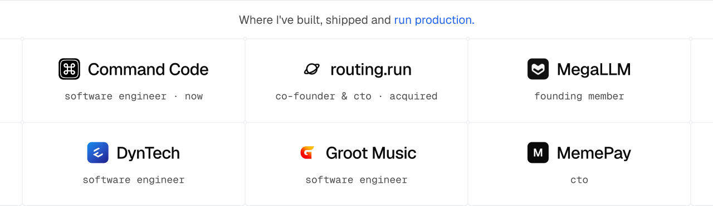
  </picture>
</a>

  <i>Head of Krishna</i> by Sahib Ram, Jaipur, ca. 1800, <a href="https://www.metmuseum.org/art/collection/search/37877">The Met</a>, CC0. Set in Geist. The images are drawn by <a href=".github/readme">.github/readme</a>.

